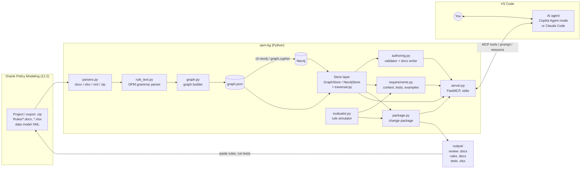
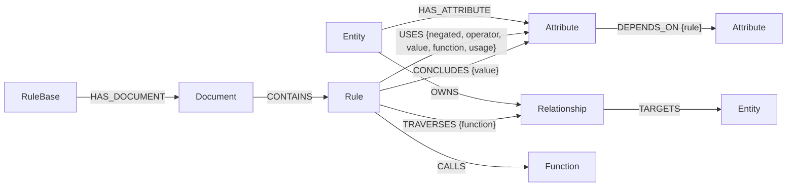
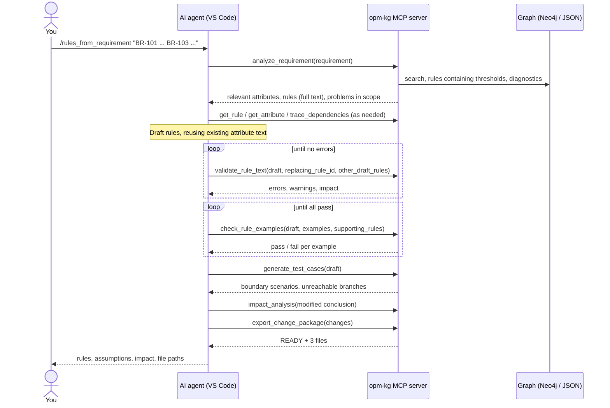
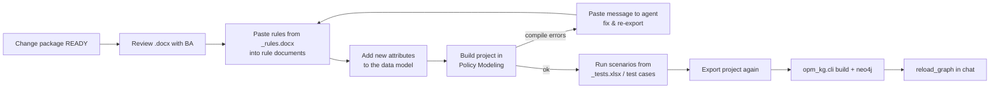

# OPM Knowledge Graph + AI Agent: Architecture and VS Code Setup

This guide explains how **opm-kg** turns an Oracle Intelligent Advisor (OPM 12.2) rulebase into a knowledge graph. It also covers how an AI agent in VS Code uses that graph to answer questions about your rules, and to write or modify rules from business requirements.

> The diagrams use Mermaid. They render on GitHub and GitLab. In VS Code, install the **Markdown Preview Mermaid Support** extension and open the preview with `Ctrl+Shift+V`.

---

## Contents

1. [What it does](#1-what-it-does)
2. [Architecture](#2-architecture)
3. [Prerequisites](#3-prerequisites)
4. [Setup in VS Code](#4-setup-in-vs-code)
5. [Using the agent](#5-using-the-agent)
6. [Applying changes in Policy Modeling](#6-applying-changes-in-policy-modeling)
7. [Tool reference](#7-tool-reference)
8. [Rule text format](#8-rule-text-format-quick-reference)
9. [Troubleshooting](#9-troubleshooting)
10. [Limitations](#10-limitations)
11. [Project layout](#11-project-layout)

---

## 1. What it does

| Part | Purpose |
|---|---|
| **Part 1: Knowledge graph** | Parses your rulebase (Word rules, Word and Excel rule tables, the data model) into a graph of rules, attributes, entities and dependencies. The graph is stored in Neo4j or in a JSON file. |
| **Part 2: Rule authoring agent** | An MCP server gives the AI agent in VS Code tools to search the graph, trace lineage, run impact analysis, validate draft rules, simulate them against examples, generate test cases, and export a change package ready for Policy Modeling. |

The **agent writes the rules**. The **tools supply facts and check the agent's work**, so the output is grounded in your real rulebase rather than guessed.

---

## 2. Architecture

### 2.1 Component view



### 2.2 Layers

| Layer | Module(s) | Responsibility |
|---|---|---|
| Ingestion | `parsers.py` | Reads `.zip` (including nested zips), folders, `.docx` (OPM styles and rule tables), `.xlsx` (OPM heading styles, or first column as the conclusion) and data model `.xml`/`.xprj`. Skips lock files, non-rule tables and READMEs. Gives rules unique IDs even when two documents share a file name. |
| Grammar | `rule_text.py` | Parses OPM rule text into attribute references. Handles `if`, `and`/`or`, `both`/`either`/`all`/`any` groups, negation (`not`, `not(...)`, `it is not the case that`, negative forms), comparisons, arithmetic, quoted text, functions and entity functions. |
| Graph | `graph.py`, `model.py` | Builds nodes and edges, infers attribute types from how attributes are used, resolves curly apostrophes and negative forms, and exports JSON. |
| Storage | `graph.json` or Neo4j (`neo4j_store.py`) | Two interchangeable backends with the same query API. |
| Traversal | `traversal.py` | Lineage (upstream), impact (downstream), dependency closure and cycle detection, shared by both backends. |
| Authoring | `authoring.py` | Validates rule structure, data-model types, duplicate proofs and circularity, taking the other draft rules into account. Writes Word output in OPM styles, and writes multi-outcome rules as rule tables. |
| Simulation | `evaluator.py` | Runs rule text on test facts using three-valued logic (true, false, unknown), with dates, arithmetic and common functions. It can chain through other draft rules or through the rulebase. |
| Requirements | `requirements.py` | Retrieves the graph context a requirement touches, including thresholds that already appear in rules. Also generates boundary tests and checks worked examples. |
| Packaging | `package.py` | Builds the review document, the OPM-styled rules document and the test workbook. The package is marked READY or NEEDS WORK. |
| Interface | `server.py`, `guide.py` | The FastMCP server with 19 tools, the `rules_from_requirement` prompt and the `opm://authoring-guide` resource. |

### 2.3 Graph schema



| Node | Key | Main properties |
|---|---|---|
| `Rule` | `id` (e.g. `Rules/Eligibility.docx#rule 3`) | `text`, `conclusion`, `name`, `section`, `document`, `kind` (word, table or excel) |
| `Attribute` | `key` (normalised text) | `text`, `entity`, `type`, `public_name`, `negative_text`, `source` (data model or `inferred`) |
| `Entity` | `name` | `text`, `parent` |
| `Relationship` | `key` | `text` |

`DEPENDS_ON` is derived from each rule and runs from the conclusion to every condition. It drives lineage, impact analysis and cycle detection.

### 2.4 Requirement-to-rules flow



### 2.5 Deployment options

| Option | Graph store | When to use |
|---|---|---|
| **A. JSON** | `graph.json` file | Quickest start. No database, and it works offline. |
| **B. Neo4j** | Neo4j 5.x (Desktop or Docker) | Large rulebases, ad-hoc Cypher exploration, and graphs shared across a team |

The MCP server behaves the same with either store. Switch between them with the `OPM_KG_BACKEND` environment variable.

---

## 3. Prerequisites

| Item | Version | Notes |
|---|---|---|
| Windows, macOS or Linux | – | Policy Modeling itself runs on Windows |
| Python | 3.10+ | `py --version` on Windows |
| VS Code | Recent | Plus the **Python** extension |
| An AI agent in VS Code that supports MCP | – | **GitHub Copilot Chat** (Agent mode) or the **Claude Code** extension |
| Neo4j (optional) | 5.x | Neo4j Desktop, or Docker `neo4j:5` |
| Rulebase export | IA 12.2 | Project export `.zip` or the project folder |

---

## 4. Setup in VS Code

### Step 1: Open the project

1. Unzip `opm-kg.zip`, for example to `C:\opm-kg`.
2. In VS Code, choose **File → Open Folder → `C:\opm-kg`**.

### Step 2: Create the Python environment

Open a terminal (**Terminal → New Terminal**):

```powershell
py -m venv .venv
.venv\Scripts\activate
pip install -r requirements.txt
```

On macOS or Linux, use `python3 -m venv .venv`, then `source .venv/bin/activate`.

If PowerShell blocks activation, run `Set-ExecutionPolicy -Scope CurrentUser RemoteSigned` once.

Then choose the interpreter: `Ctrl+Shift+P` → **Python: Select Interpreter** → `.venv`.

### Step 3: Verify the installation

```powershell
python tests\run_tests.py
```

Expected result: `55 passed, 0 failed`. The run includes a synthetic rulebase of 3,000 rules and takes about a minute.

Optionally, run the end-to-end demo:

```powershell
python examples\run_demo.py
```

It writes a sample change package to `output\demo\`.

### Step 4: Build the knowledge graph from your rulebase

Copy your export into the folder, for example `C:\opm-kg\MyRulebase.zip`, then:

```powershell
python -m opm_kg.cli inspect MyRulebase.zip
python -m opm_kg.cli build   MyRulebase.zip -o graph.json --cypher graph.cypher
```

The `inspect` command is optional. It lists the files and XML structure the tool finds.

- `build` prints counts of rules, attributes, entities and base inputs.
- **Warnings** name any file that couldn't be parsed, for example a corrupt document. If a whole XML file isn't recognised, send its `inspect` output so the parser can be adapted.
- `graph.cypher` is only needed if you load Neo4j with `cypher-shell`.

### Step 5 (optional): Load into Neo4j

1. Start Neo4j 5.x with **one** of these:
   - **Neo4j Desktop:** create a local DBMS, set a password and start it.
   - **Docker:**
     ```powershell
     docker run -d --name neo4j -p 7474:7474 -p 7687:7687 -e NEO4J_AUTH=neo4j/YourPassword neo4j:5
     ```
2. Load the graph. This replaces any existing OPM nodes, so reloading is safe.
   ```powershell
   python -m opm_kg.cli neo4j graph.json --uri bolt://localhost:7687 --user neo4j --password YourPassword
   ```
   If you don't have the Python driver installed, use `cypher-shell -u neo4j -p YourPassword -f graph.cypher` instead.
3. Check the result at http://localhost:7474:
   ```cypher
   MATCH (n) RETURN labels(n)[0] AS label, count(*) ORDER BY label;
   ```

### Step 6: Register the MCP server

#### Option A: GitHub Copilot (Agent mode)

The project already contains `.vscode/mcp.json`. Edit the backend settings:

```json
{
  "inputs": [
    { "id": "neo4jPassword", "type": "promptString", "description": "Neo4j password", "password": true }
  ],
  "servers": {
    "opm-kg": {
      "type": "stdio",
      "command": "${workspaceFolder}\\.venv\\Scripts\\python.exe",
      "args": ["${workspaceFolder}\\server.py"],
      "env": {
        "OPM_KG_BACKEND": "json",
        "OPM_KG_GRAPH": "${workspaceFolder}\\graph.json",
        "NEO4J_URI": "bolt://localhost:7687",
        "NEO4J_USER": "neo4j",
        "NEO4J_PASSWORD": "${input:neo4jPassword}",
        "OPM_KG_OUTPUT_DIR": "${workspaceFolder}\\output"
      }
    }
  }
}
```

- To use Neo4j, set `"OPM_KG_BACKEND": "neo4j"`.
- Open `mcp.json` and click **Start** above `"opm-kg"`. Enter the Neo4j password if asked.
- Open Chat (`Ctrl+Alt+I`), switch to **Agent** mode, click the **tools** icon and make sure the `opm-kg` tools are ticked.

#### Option B: Claude Code extension

Create `.mcp.json` in the project root:

```json
{
  "mcpServers": {
    "opm-kg": {
      "command": ".venv/Scripts/python.exe",
      "args": ["server.py"],
      "env": {
        "OPM_KG_BACKEND": "json",
        "OPM_KG_GRAPH": "graph.json",
        "OPM_KG_OUTPUT_DIR": "output"
      }
    }
  }
}
```

On macOS or Linux, set `command` to `.venv/bin/python`. For Neo4j, add `NEO4J_URI`, `NEO4J_USER` and `NEO4J_PASSWORD`. You can reference an environment variable, for example `"${NEO4J_PASSWORD}"`, so the password isn't stored in the file.

Approve the server when Claude Code asks. `/mcp` shows its status.

### Step 7: Smoke test

In chat, ask:

> Use opm-kg: give me the rulebase overview and run the diagnostics.

You should get counts plus a list of problems: attributes proven twice, dependency cycles, and attributes that are unused or missing from the data model.

---

## 5. Using the agent

### 5.1 Ask questions about the rulebase

| You ask | Tools the agent uses |
|---|---|
| "Which rules use *the applicant's annual income*?" | `get_attribute` |
| "What does eligibility depend on, down to the inputs?" | `trace_dependencies` |
| "If I change the age test, what else is affected?" | `impact_analysis` |
| "Show me the rules in Payments.xlsx." | `list_rules_in_document`, `get_rule` |
| "Which attributes are asked on screens (base inputs)?" | `list_base_attributes` |
| "Is anything proven twice or circular?" | `rulebase_diagnostics` |

### 5.2 Modify a single rule

> Change the age test so the minimum age is 21. Validate it and export it to docx.

The agent runs `get_rule`, then `validate_rule_text` with `replacing_rule_id`, then `impact_analysis`, then `export_rules_docx`.

### 5.3 Generate rules from a business requirement (recommended)

- **Copilot:** type `/` → **mcp.opm-kg.rules_from_requirement** and paste the requirement.
- **Claude Code:** type `/mcp__opm-kg__rules_from_requirement` and paste the requirement.

You can also just say: *"Using opm-kg, write the rules for this requirement: …"*

A good requirement has **numbered statements** and **worked examples**:

```text
BR-101: The minimum age for social support is raised from 18 to 21. The upper limit (under 67) is unchanged.
BR-102: Introduce a weekly hardship top-up. Eligible applicants with annual income below 15,000 receive
        60 per week with 3 or more children, 40 with 1 or 2 children, and nothing otherwise.
BR-103: Applicants flagged for review must not receive the top-up.
Example: an eligible applicant earning 12,000 with 2 children gets 40; with 4 children, 60;
         earning exactly 15,000, nothing.
```

The agent then:

1. Runs `analyze_requirement` to find the relevant attributes and rules. This includes the rule that currently contains `>= 18`, and existing problems such as the age test being proven twice.
2. Breaks the requirement into changes, each one **modifying** an existing rule or **adding** a new one.
3. Drafts the rules, reusing the exact attribute text.
4. Runs `validate_rule_text` until there are no errors.
5. Runs `check_rule_examples`. Every worked example must pass, including end-to-end examples that flow through several new rules.
6. Runs `generate_test_cases`, which covers boundaries and flags unreachable branches.
7. Runs `impact_analysis` to find rules that need retesting.
8. Runs `export_change_package`, which must report **READY**.

### 5.4 Outputs

These are written to `output\` (or `OPM_KG_OUTPUT_DIR`):

| File | Audience | Content |
|---|---|---|
| `<name>.docx` | BA, reviewer | Requirement, summary table, and for each change: current rule, proposed rule, validation, impact, example results and test scenarios |
| `<name>_rules.docx` | Rule developer | The rules only, in OPM styles. Multi-outcome value rules are written as Word rule tables. |
| `<name>_tests.xlsx` | Tester | Scenario inputs with expected results, one sheet per change, plus the example checks |

---

## 6. Applying changes in Policy Modeling



1. Review the `.docx` package and confirm the assumptions the agent listed.
2. For **modified** rules, replace the rules named in the **Replaces** column. When several are listed, keep one rule and delete the rest.
3. For **new** rules, paste them into the relevant rule document and add any new attributes, with a type and public name, to the data model.
4. Build the project. If Policy Modeling reports an error, paste the message into chat and ask the agent to fix the rule.
5. Run the test scenarios.
6. **Refresh the graph** so the agent sees the new rulebase:
   ```powershell
   python -m opm_kg.cli build MyRulebase.zip -o graph.json
   python -m opm_kg.cli neo4j graph.json --password YourPassword   # if using Neo4j
   ```
   Then tell the agent: *"reload the graph"* (`reload_graph`).

---

## 7. Tool reference

| Tool | Purpose |
|---|---|
| `rulebase_overview` | Counts of rules, attributes, entities, documents and base inputs |
| `search` | Keyword search. `kind` can be `attribute`, `rule`, `entity`, `document` or `function`. |
| `get_attribute` | Type, entity, the rules that prove the attribute and the rules that use it. Accepts negative forms. |
| `get_rule` | Full rule text with its conclusions, conditions, functions and relationships. Partial IDs work. |
| `trace_dependencies` | Upstream lineage down to the base inputs |
| `impact_analysis` | Downstream attributes and the rules to retest |
| `list_rules_in_document`, `list_entities`, `get_entity`, `list_base_attributes` | Browse the rulebase |
| `rulebase_diagnostics` | Attributes proven more than once, cycles, and attributes that are unused or missing from the data model |
| `validate_rule_text` | Checks structure, types, duplicate proofs, cycles and unknown attributes. `replacing_rule_id` accepts `A\|B`, and `other_draft_rules` lets drafts see each other. |
| `export_rules_docx` | Writes OPM-styled rules to a .docx |
| `analyze_requirement` | Retrieves the graph context for a business requirement |
| `evaluate_rule` | Simulates a rule on facts. Options: `supporting_rules`, `use_rulebase`, `today`. |
| `check_rule_examples` | Checks worked examples, and can run through a chain of draft rules |
| `generate_test_cases` | Boundary and combination scenarios, plus unreachable branches |
| `export_change_package` | Writes the review .docx, the rules .docx and the tests .xlsx, with READY or NEEDS WORK |
| `reload_graph` | Picks up a rebuilt graph without restarting the server |
| Prompt `rules_from_requirement` | The guided requirement-to-rules workflow |
| Resource `opm://authoring-guide` | Syntax, naming conventions and the workflow |

When something goes wrong, for example a missing graph file, Neo4j being unreachable or a bad parameter, tools return `{"error": ..., "kind": ...}` instead of crashing.

---

## 8. Rule text format (quick reference)

The tools use plain text with **2 spaces per indentation level**:

```text
the applicant meets the residency requirement if
  the applicant is a citizen or
  both
    the applicant is a permanent resident and
    the applicant's years of residence >= 2
```

| Construct | Form |
|---|---|
| Boolean conclusion | `<attribute> if` |
| Value conclusion | `<attribute> = <expression> if` |
| Calculation | `<attribute> = <expression>` (no conditions) |
| Several outcomes | One `= value if` line per outcome, most specific first, ending with `<attribute> = <default> otherwise` |
| Connectors | End each condition with `and` or `or` when a sibling follows. Don't mix them at one level. |
| Groups | `both` / `all` (joined by and), `either` / `any` (joined by or). A group's own connector goes on its last line. |
| Negation | Prefer the negative form (`the applicant is not a citizen`) |
| Comparisons | `=  <>  <  >  <=  >=`; text in `"quotes"`; dates as `Date(2026, 4, 1)` |
| Entity functions | `ForAll(rel, stmt)`, `Exists(...)`, `InstanceCount(rel)`, `InstanceSum(rel, attr)`, `InstanceCountIf(rel, stmt)` |

Naming conventions:

- Reuse the existing attribute text exactly.
- Booleans take the form "the *entity* *verb phrase*".
- Values take the form "the *entity*'s *noun*".
- Only one rule may prove each attribute.

---

## 9. Troubleshooting

| Symptom | Fix |
|---|---|
| The server doesn't start in VS Code | Check that the `command` path points to `.venv\Scripts\python.exe`. Look at **Output → MCP: opm-kg**. |
| `graph file not found` | Run Step 4, or correct `OPM_KG_GRAPH` |
| `cannot connect to Neo4j` | Neo4j isn't running, or the URI or password is wrong. Test at http://localhost:7474. |
| `'neo4j' Python package is not installed` | Run `pip install neo4j` in the `.venv` |
| `build` reports 0 rules or XML warnings | Run `inspect` on the export and share the output so the parser can be adapted |
| The agent doesn't use the tools | Make sure chat is in Agent mode and the tools are ticked. Mention "using opm-kg" in your request. |
| Counts differ between the JSON and Neo4j backends | Reload with `cli neo4j` (it replaces existing nodes), then run `reload_graph` |
| Policy Modeling rejects an exported rule | Paste the compile message into chat, and the agent will fix the rule and re-export |
| Answers seem stale | Rebuild the graph, then run `reload_graph` |

---

## 10. Limitations

- **Simulation scope:** the evaluator doesn't run entity functions (`ForAll`, `InstanceCount`, …) or temporal functions. Those rules are marked "not simulated" and must be tested in Policy Modeling.
- **OPM syntax:** the exported Word syntax (OPM styles, rule tables, negative forms) follows the standard conventions. Compiling in Policy Modeling is the final check.
- **Neo4j queries:** these have been reviewed, and their traversal logic is tested for parity with the JSON backend, but they have not been run against a live database in this build. Compare `rulebase_overview` on both backends after loading.
- **Compiled-only exports:** if your export contains only compiled XML and no source rule documents, the XML parser may need adapting. Share the `inspect` output.
- **The agent makes judgment calls:** it states its interpretations, for example reading "below 15,000" as `< 15000`. Review the assumptions section of every change package.

---

## 11. Project layout

```text
opm-kg/
├─ .vscode/mcp.json          VS Code (Copilot) MCP registration
├─ server.py                 FastMCP server: 19 tools, 1 prompt, 1 resource
├─ requirements.txt
├─ README.md
├─ docs/
│  └─ SETUP_AND_ARCHITECTURE.md   this guide
├─ opm_kg/
│  ├─ model.py               data classes, text normalisation
│  ├─ rule_text.py           OPM grammar parser
│  ├─ parsers.py             docx / xlsx / xml / zip ingestion
│  ├─ graph.py               graph builder + JSON store
│  ├─ neo4j_store.py         Neo4j loader, Cypher export, Neo4j store
│  ├─ traversal.py           lineage, impact, cycles (shared)
│  ├─ authoring.py           validator + OPM Word writer
│  ├─ evaluator.py           rule simulator
│  ├─ requirements.py        requirement context, tests, examples
│  ├─ package.py             change package export
│  ├─ guide.py               authoring guide + workflow prompt
│  └─ cli.py                 inspect / build / neo4j / validate
├─ examples/run_demo.py      end-to-end requirement → change package demo
├─ sample/                   small HousingBenefit sample + prebuilt graph
└─ tests/                    55 tests (python tests/run_tests.py)
```
